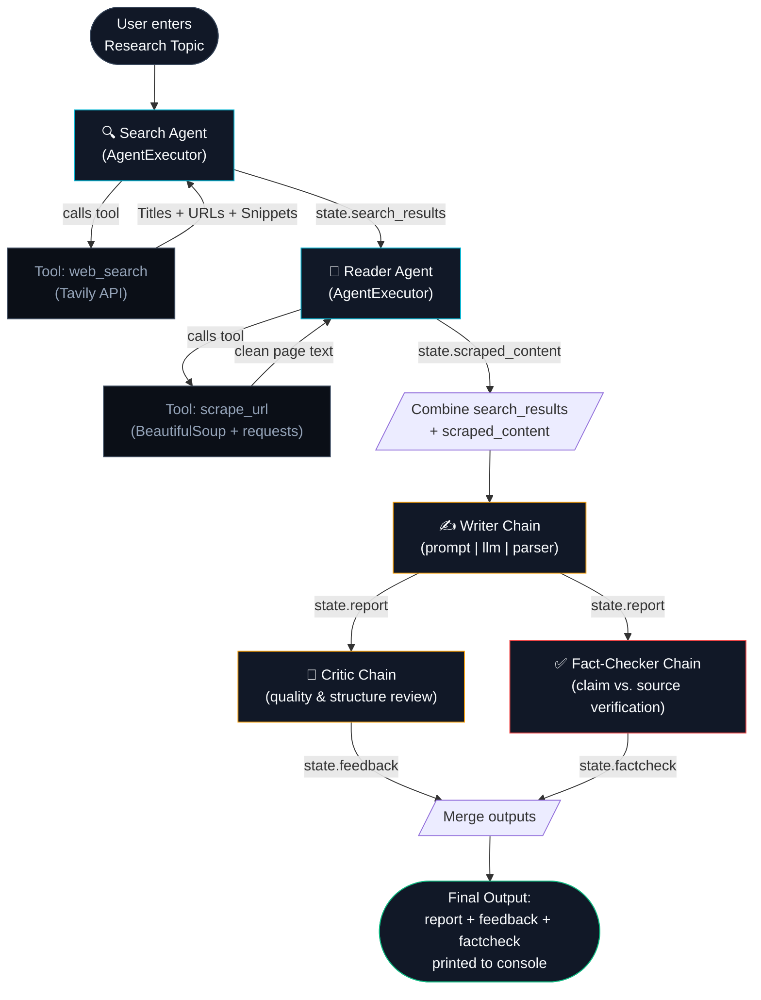

# Synapse — Multi-Agent Research Assistant
## Full System Architecture

---

## 1. High-Level Flow Diagram



---

## 2. Component Breakdown

### 2.1 Search Agent
- **Type:** `create_agent` (AgentExecutor) — decides itself when/how to call its tool
- **Tool used:** `web_search` → wraps Tavily API
- **Input:** research topic (plain text)
- **Output:** raw `ToolMessage` content containing Title + URL + Snippet for top results
- **Key detail:** the pipeline extracts the **raw `ToolMessage`** output (not the agent's final summarized `AIMessage`), because the summary tends to drop the actual URLs

### 2.2 Reader Agent
- **Type:** `create_agent` (AgentExecutor)
- **Tool used:** `scrape_url` → BeautifulSoup + requests
- **Input:** the search results (with real URLs) from the Search Agent
- **Output:** cleaned, scraped page text (script/style/nav/footer stripped, capped at 3000 characters)

### 2.3 Writer Chain
- **Type:** simple LCEL chain (`prompt | llm | StrOutputParser`) — no tool-use decisions needed
- **Input:** topic + combined research (search results + scraped content)
- **Output:** structured report — Introduction, Key Findings, Conclusion, Sources

### 2.4 Critic Chain
- **Type:** LCEL chain
- **Job:** judges **writing quality** — structure, depth, clarity
- **Output:** score /10 + strengths + areas to improve + one-line verdict
- **Does NOT check factual accuracy** — that's the Fact-Checker's job

### 2.5 Fact-Checker Chain
- **Type:** LCEL chain
- **Job:** compares the Writer's report against the original scraped content to catch **hallucinated or unsupported claims**
- **Output:** verified claims list + unsupported/questionable claims list + accuracy score /10

---

## 3. Tech Stack

| Layer | Technology |
|---|---|
| Orchestration | LangChain (`create_agent` + LCEL chains) |
| LLM | Mistral AI (`ChatMistralAI`, model: `open-mistral-nemo`) |
| Web Search | Tavily API |
| Web Scraping | BeautifulSoup4 + requests |
| Env Management | python-dotenv |
| Interface (current) | Python CLI (`pipeline.py`) / Streamlit (`app.py`) |

---

## 4. Planned Additions (Not Yet in Diagram)

These will extend the pipeline once implemented — each will be added as a new node feeding into or branching from the flow above:

- **Source Credibility Scorer** — new tool, scores each URL before scraping
- **Human-in-the-Loop Checkpoint** — inserted between Writer Chain and final output; user approves/rejects before it's finalized
- **Multi-URL Scraping** — Reader Agent extended to scrape top 2–3 URLs instead of 1
- **Multi-format Export** — new node after `MERGE`, converts final output to PDF/Markdown
- **Persistent History (MongoDB)** — new node after `MERGE`, saves each run for later retrieval
- **Live Progress Tracker / Streaming** — will depend on whatever backend/UI layer is added later, not a new agent

---

## 5. State Object Reference

All intermediate outputs flow through a shared `state` dictionary:

```python
state = {
    "search_results":  str,   # raw Tavily results (Title/URL/Snippet)
    "scraped_content":  str,  # cleaned scraped page text
    "report":  str,           # Writer Chain output
    "feedback":  str,         # Critic Chain output
    "factcheck":  str,        # Fact-Checker Chain output
}
```

---

*This document reflects the architecture as of the current implementation. Update this file as new features (credibility scoring, HITL, export, memory) are added to the pipeline.*